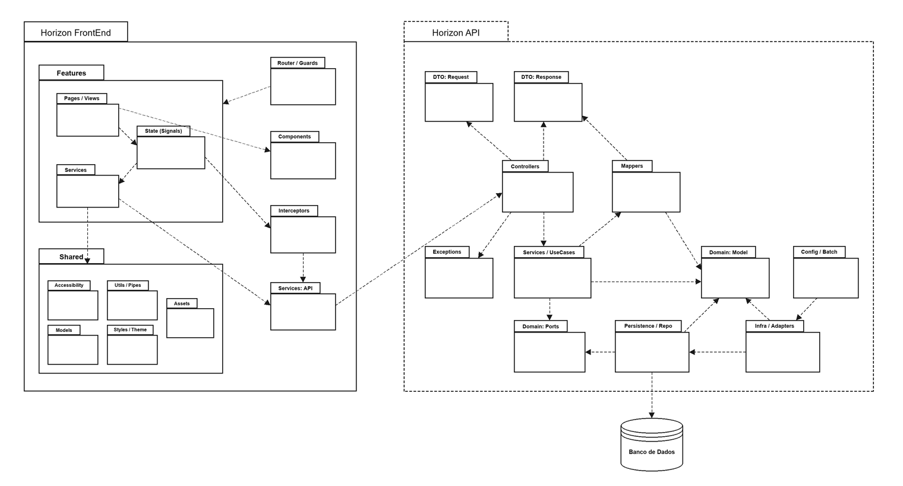

# Horizon

O **Horizon** é uma plataforma digital inteligente de turismo e aviação civil desenvolvida para transformar a busca e o planejamento de viagens em uma experiência intuitiva, fluida e personalizada. A aplicação combina um questionário afetivo e interativo (Quiz de DNA do Viajante), um feed dinâmico com gamificação e enquetes, e um motor proprietário de recomendação baseado em espaço vetorial multidimensional (composição híbrida 60/40), conectando preferências comportamentais a destinos turísticos e malha aérea em tempo real. Construído sob os princípios da Arquitetura Hexagonal (Ports & Adapters) e alinhado aos padrões internacionais de acessibilidade digital (WCAG 2.1 AA).

---

## 🏛️ Arquitetura do Sistema

O projeto adota rigorosamente a **Arquitetura Hexagonal** (Ports and Adapters), garantindo desacoplamento entre as regras de negócio centrais e frameworks ou tecnologias externas:



### Camadas Arquiteturais:
* **Domain (`br.com.horizon.horizon_api.domain`):** Entidades de negócio puras, objetos de valor, regras de recomendação vetorial e contratos de portas (`ports`), sem dependência de frameworks externos.
* **Application (`br.com.horizon.horizon_api.application`):** Casos de uso (`usecase`), serviços de orquestração (`service`), DTOs de entrada/saída e mappers.
* **Infrastructure (`br.com.horizon.horizon_api.infrastructure`):** Adaptadores de persistência (Spring Data JPA, PostgreSQL), processamento em lote (Spring Batch), adaptadores de e-mail (SMTP), segurança (JWT) e armazenamento de mídia (Cloudinary).
* **Interface (`br.com.horizon.horizon_api.interfaces`):** Controladores REST (`rest`), interceptores HTTP, filtros de segurança e documentação Swagger/OpenAPI.

---

## 🌟 Funcionalidades e Diferenciais

* **Motor de Recomendação Vetorial Multidimensional:** Compatibilidade baseada na fórmula $\text{match}(u, d) = \max(0, 1 - |u - d|)$ com ponderação híbrida entre preferências declaradas (60%) e interações comportamentais (40%), além de penalização orçamentária e restrição de passaporte para viagens internacionais.
* **Classes de Voo Oficiais:** Experiência de voo padronizada nas classes **Básico**, **Executivo** e **Premium**, com seleção dinâmica de assentos na cabine da aeronave.
* **Emissão de Bilhetes em PDF com QR Code:** Geração automatizada de bilhetes aéreos e cartões de embarque estilizados utilizando a biblioteca iText.
* **Previsão Climática em Tempo Real:** Integração com a API Open-Meteo para exibir a temperatura e as condições meteorológicas históricas e futuras dos destinos recomendados.
* **Rotinas Automatizadas em Lote (Spring Batch):** Cancelamento automático de reservas pendentes com mais de 24 horas, conclusão de voos finalizados e apuração trienal com envio de relatório executivo de satisfação por e-mail.
* **Acessibilidade Digital Universal (WCAG 2.1 AA):** Suporte nativo a alto contraste, escalonamento flexível de fontes tipográficas, leitor de tela integrado via Web Speech API e compatibilidade com VLibras.
* **Central de Ajuda e Suporte com Protocolo Digital:** Sistema de chamados com geração de protocolo sequencial (`HZ-2026-XX`), anexos de até 5 MB e SLA transparente de primeira resposta (de 2h a 48h úteis conforme a prioridade).
* **Pesquisa de Satisfação Contínua:** Coleta transacional de CSAT (1 a 5 estrelas) no término do Quiz e Checkout, e NPS (0 a 10) no Perfil e pós-viagem.

---

## 🚀 Começando

Estas instruções permitirão que você obtenha uma cópia do projeto em operação na sua máquina local para fins de desenvolvimento, avaliação e testes.

Consulte a seção de [Implantação](#-implantação) para instruções sobre como executar a aplicação em ambiente de produção (Render / Neon).

---

## 📋 Pré-requisitos

Para executar o ecossistema completo do Horizon localmente, você precisará das seguintes ferramentas instaladas:

* **Java Development Kit (JDK) 25** (Recomendado: Eclipse Temurin 25 ou OpenJDK 25)
* **Node.js** (versão 22.x ou superior) e gerenciador de pacotes **npm**
* **Apache Maven 3.9+** (opcional, pois o repositório já inclui o `mvnw` e `mvnw.cmd`)
* **PostgreSQL 16+** (local ou instância gerenciada em nuvem como Neon DB)
* **Navegador Web Moderno** (Google Chrome, Microsoft Edge ou Firefox)

---

## 🔧 Instalação

Siga o passo a passo abaixo para configurar e inicializar o ambiente de desenvolvimento:

### 1. Clonagem dos Repositórios

Abra o terminal e clone os repositórios do Backend e Frontend:

```bash
# Clone do Backend (Horizon API)
git clone https://github.com/tba-txt/Horizon-Travel.git horizon-api

# Clone do Frontend (Horizon Web)
git clone https://github.com/tba-txt/horizon-web.git horizon-web
```

---

### 2. Configuração do Backend (`horizon-api`)

Navegue até a pasta do backend e crie o arquivo de variáveis de ambiente `.env` com base no `.env.example`:

```bash
cd horizon-api
cp .env.example .env
```

Preencha as variáveis de ambiente necessárias no arquivo `.env`:

```env
# Banco de Dados PostgreSQL
DB_URL=jdbc:postgresql://localhost:5432/horizon_db
DB_USER=seu_usuario
DB_PASSWORD=sua_senha

# Autenticação e Segurança
JWT_SECRET=sua_chave_secreta_jwt_longa_e_segura

# Armazenamento de Imagens (Cloudinary)
CLOUDINARY_NAME=seu_cloud_name
CLOUDINARY_KEY=sua_api_key
CLOUDINARY_SECRET=seu_api_secret

# Envio de E-mails Transacionais (SMTP Gmail)
MAIL_USERNAME=seu_email@gmail.com
MAIL_PASSWORD=sua_senha_de_app_16_digitos
```

Inicialize o servidor backend:

```bash
# No Windows PowerShell / CMD:
.\mvnw.cmd spring-boot:run

# No Linux / macOS:
./mvnw spring-boot:run
```

O backend estará ativo em `http://localhost:8080`.
* A documentação interativa das APIs (Swagger / OpenAPI UI) estará acessível em: `http://localhost:8080/swagger-ui.html`
* A verificação de integridade da aplicação pode ser consultada em: `http://localhost:8080/actuator/health`

---

### 3. Configuração do Frontend (`horizon-web`)

Em outro terminal, navegue até a pasta do frontend e instale as dependências:

```bash
cd horizon-web
npm install
```

Inicie o servidor de desenvolvimento do Angular:

```bash
npm start
```

Abra o navegador em `http://localhost:4200` para interagir com o Horizon.

---

### 4. Principais Endpoints da API REST

A API do Horizon é totalmente documentada via Swagger/OpenAPI. Abaixo estão os grupos principais de endpoints:

| Módulo / Rota Base | Descrição |
| :--- | :--- |
| `POST /auth/login`, `POST /auth/register` | Autenticação com JWT e cadastro de viajantes |
| `GET /destinations`, `GET /destinations/{id}` | Catálogo de cidades e destinos com filtros climáticos |
| `GET /flights`, `GET /flights/{id}` | Consulta de malha aérea, horários e assentos operantes |
| `GET /quizzes/active`, `POST /quizzes/submit` | Obtenção do Quiz e submissão das preferências de viagem |
| `GET /recommendations` | Cálculo em tempo real do ranking de destinos com match vetorial |
| `POST /reservations`, `GET /reservations/{id}` | Reserva atômica de assentos e geração do bilhete |
| `POST /payments/confirm` | Confirmação e conciliação de pagamentos simulados (PIX / Cartão) |
| `POST /feedbacks`, `GET /feedbacks/metrics` | Registro de notas CSAT/NPS e apuração consolidada |
| `POST /support-tickets`, `GET /support-tickets/my` | Abertura de chamados com protocolo sequencial e anexos |

---

### 5. Demonstração Prática do Sistema

Após inicializar a aplicação:
1. **Cadastro e Autenticação:** Acesse `/register` para criar uma nova conta de viajante e complete o perfil com CPF e Data de Nascimento em `/profile`.
2. **Quiz de Perfil (DNA do Viajante):** Acesse `/quiz` e deslize ou selecione seus gostos visuais para calcular o seu arquétipo de viajante e receber destinos personalizados com porcentagem real de afinidade.
3. **Reserva e Compra:** Escolha um destino, selecione os assentos da aeronave na classe desejada (**Básico**, **Executivo** ou **Premium**), simule o pagamento via PIX ou Cartão e baixe o bilhete aéreo em PDF gerado automaticamente com QR Code.
4. **Feed e Gamificação:** Acesse o Feed interativo na Home, interaja com as postagens, responda a enquetes de viagem e desbloqueie cupons de desconto.
5. **Suporte e Satisfação:** Acesse `/faq` para buscar respostas na Central de Ajuda, abra um chamado formal com protocolo sequencial (`HZ-2026-XX`) e avalie a plataforma nos modais de NPS e CSAT.

---

## ⚙️ Executando os testes

A plataforma possui uma bateria abrangente de testes automatizados cobrindo regras de negócio críticas, segurança, cálculos matemáticos do motor de recomendação e rotinas de segundo plano.

### Backend (JUnit 5, Mockito & Spring Boot Test)

Para disparar a suíte completa de testes unitários e de integração do backend:

```bash
# Execução direta via Maven Wrapper:
.\mvnw.cmd test

# Ou utilizando o script automatizado na raiz:
.\executar-testes.bat
```

### Frontend (Vitest & Angular Testing Suite)

Para rodar os testes unitários do frontend em modo headless (execução única):

```bash
# Execução via npm / Vitest:
npm test -- --watch=false

# Ou utilizando o script automatizado na raiz do frontend:
.\executar-testes.bat
```

---

### 🔩 Analise os testes de ponta a ponta

Os testes de integração e fluxos de ponta a ponta verificam a consistência da jornada do viajante de forma atômica e integrada:

* **Fluxos Críticos da Aplicação (`FlowsIntegrationTest`):** Simula os 11 cenários de negócio centrais via `MockMvc`, incluindo criação de conta, autenticação JWT, submissão do Quiz, reserva atômica de assentos em voos e cancelamento com estorno.
* **Motor de Recomendação Vetorial (`RecommendationEngineTest`):** Valida a precisão matemática da fórmula de compatibilidade dimensional $\max(0, 1 - |u - d|)$, a ponderação híbrida 60/40 (explícito x comportamental), a restrição de destinos internacionais sem passaporte ativo e a penalização linear de orçamento.
* **Tarefas Automatizadas em Lote (`BatchConfigTest` & `WeeklyFeedbackBatchTest`):** Garantem que o Spring Batch processe corretamente o cancelamento de reservas pendentes expiradas (>24h), a finalização automática de viagens concluídas e a emissão do relatório executivo trienal de métricas NPS/CSAT por e-mail.

---

### ⌨️ E testes de estilo de codificação

Garantem que o código permaneça limpo, seguro, modular e em conformidade com as boas práticas da engenharia de software:

* **Arquitetura Hexagonal Estrita:** Isolamento total do domínio contra acoplamentos de framework; as regras de negócio residem no core e dependem exclusivamente de interfaces (Ports), com implementações desacopladas na camada de infraestrutura (Adapters).
* **Validação Declarativa de Dados:** Anotações JSR-380 (Bean Validation) auditando restrições de idade (comprador $\ge 18$ anos, passageiros entre 1 e 120 anos), limites de assentos e formatos de dados cadastrais.
* **Análise Estática e Qualidade:** Cobertura de código e detecção de code smells configurada para integração com **SonarQube** via `executar-sonar.bat`.
* **Acessibilidade Digital (WCAG 2.1 AA):** Testes unitários dedicados garantindo suporte nativo a alto contraste, escalonamento responsivo de tipografia e integração com Web Speech API para síntese e reconhecimento de voz.

---

## 📦 Implantação

O ecossistema Horizon foi projetado para deploy em ambientes conteinerizados e serviços de nuvem modernos (como **Render** e **Neon Cloud**):

1. **Backend em Container Docker:**
   O repositório possui um `Dockerfile` multi-stage build otimizado baseado em `eclipse-temurin:25-jre-alpine`, executando o processo sob usuário não-root (`spring:spring`) com exposição da porta 8080:
   ```bash
   docker build -t horizon-api:latest .
   docker run -p 8080:8080 --env-file .env horizon-api:latest
   ```
2. **Hospedagem em Nuvem (Render):**
   * **Backend:** Deploy contínuo no Render configurado com Java 25, variáveis de ambiente seguras e health checks integrados em `/actuator/health`.
   * **Frontend:** Deploy estático no Render com roteamento SPA (`rewrite` para `index.html`) e conexão HTTPS com a API.
   * **Banco de Dados:** Instância gerenciada PostgreSQL no **Neon Database**, garantindo backups e conexões seguras SSL.

---

## 📁 Documentos e Artefatos do Projeto

Para consulta e aprofundamento técnico, o projeto conta com documentos detalhados disponíveis no repositório:

* **[Relatório Técnico-Científico do TCC](RELATORIO_TCC_COMPLETO.md):** Monografia completa documentando fundamentação teórica, modelagem matemática, arquitetura hexagonal e métricas de desempenho.
* **[Plano de Pesquisa de Satisfação e Suporte Contínuo](Horizon_Plano_Pesquisa_Suporte_ABNT.docx):** Documento formal contendo a metodologia de NPS, CSAT, SLAs de atendimento e plano de evolução de UX.
* **[Relatório Consolidado da Bateria de Testes](TEST_REPORT.md):** Evidências metodológicas dos testes unitários, testes de integração e cenários de controle.
* **[Checklist de Implantação em Nuvem](DEPLOY_RENDER.md):** Guia operacional de configuração de variáveis, SSL e monitoramento no Render.

---

## 🛠️ Construído com

As principais tecnologias e bibliotecas utilizadas no desenvolvimento do Horizon:

* [Java 25](https://openjdk.org/projects/jdk/25/) - Linguagem de programação robusta utilizada no backend
* [Spring Boot 4.1.0](https://spring.io/projects/spring-boot) - Framework corporativo para microsserviços e APIs REST
* [Spring Batch](https://spring.io/projects/spring-batch) - Processamento em lote de cancelamentos e relatórios de métricas
* [Spring Security](https://spring.io/projects/spring-security) & [Java-JWT (Auth0)](https://github.com/auth0/java-jwt) - Autenticação stateless com tokens JWT
* [Angular 22](https://angular.dev/) - Framework SPA frontend moderno baseado em Signals e Standalone Components
* [TypeScript 6](https://www.typescriptlang.org/) - Tipagem estática e segurança no desenvolvimento web
* [PostgreSQL](https://www.postgresql.org/) & [Spring Data JPA / Hibernate](https://spring.io/projects/spring-data-jpa) - Persistência relacional robusta
* [Vitest](https://vitest.dev/) & [JUnit 5 / Mockito](https://junit.org/junit5/) - Testes unitários e de integração
* [Cloudinary SDK](https://cloudinary.com/) - Gerenciamento e otimização de imagens em nuvem
* [iText PDF](https://itextpdf.com/) - Geração dinâmica e estilizada de bilhetes e cartões de embarque em PDF
* [Open-Meteo API](https://open-meteo.com/) - Integração climática com previsão em tempo real nos destinos
* [SpringDoc OpenAPI / Swagger](https://springdoc.org/) - Documentação viva e interativa dos endpoints da API

---

## 🖇️ Colaborando

Por favor, leia as diretrizes de contribuição, padrões de commit e fluxo de trabalho nos documentos do repositório para detalhes sobre nosso fluxo de desenvolvimento e branches.

---

## 📌 Versão

Nós usamos [SemVer](http://semver.org/) para controle de versão. Para as versões disponíveis, observe as tags e lançamentos neste repositório.

---

## ✒️ Autores

* **Gabriel Santana** (*Gabriel Oliveira de Santana*) - *Idealização, Desenvolvimento Full-Stack, Arquitetura Hexagonal, UX/UI & Documentação* - [tba-txt](https://github.com/tba-txt)

---

## 📄 Licença

Este projeto está sob a licença **MIT** para fins acadêmicos e de portfólio.

---

## 🎁 Expressões de gratidão

* Agradecimento aos professores e orientadores da FATEC pela condução acadêmica e suporte técnico 🎓;
* Compartilhe o projeto com outros viajantes e desenvolvedores 📢;
* Um café quente para acompanhar os deploys ☕;

---
⌨️ com dedicação por [Gabriel Santana](https://github.com/tba-txt) 😊
